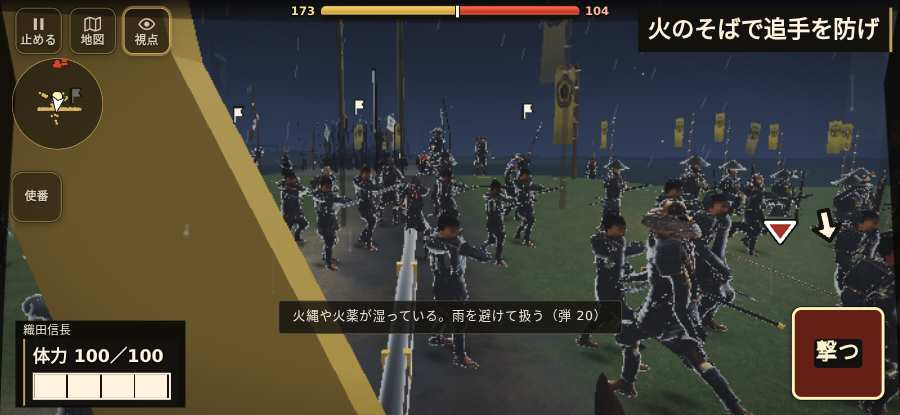

# テストプレイヤーの感想：アクション好き

- 人：ソウタ（24歳・アクションゲーム好き）（3027番）
- 変わり目：構え多め・iPhone 横 932×430・信長で出陣・ふつう・足軽から・問屋:買わない・一人称・感度 鈍い・止めない
- 時：2026/10/24 19:51:01（175秒かかった）
- 画面：iPhone の横向き 932×430・倍率3・指で触る操作（touch.js の釦・棒・なぞり）・画質 高
- 遊んだ戦：手取川の戦い（信長で出陣）（失敗・倒れた）
- 機械の混み具合：3（load average）

## ひとこと

> とにかく突っ込んだ。7分で0人斬った。HUD の札どうしが重なって読めない、ストレスたまる。戦場が札に食われている、ストレスたまる。前へ進もうとしても進めない所があった、手応えがスカスカ。1回やられた。難しいのはいいけど、何でやられたか分かるようにしてほしい。

## 見つけた問題（11件・困った順）

### 1. HUD の札どうしが重なって読めない
- どこで：手取川の戦い（信長で出陣）・5秒・brief
- 何が：.bl.hz-has-73 と .field-names（932×430）／#h-prog と .field-names（932×430）
- どれくらい困ったか：★★ かなり困った（428回）
- 直し方の目安：置き場所をずらすか、片方を出している間はもう片方を隠す
- 画面：（その戦の山場の一枚）

### 2. 戦場が札に食われている（画面の3分の1超）
- どこで：手取川の戦い（信長で出陣）・5秒・brief
- 何が：932×430 で 100%
- どれくらい困ったか：★★ かなり困った（84回）
- 直し方の目安：札を小さくするか、平時は薄く・畳む
- 画面：（その戦の山場の一枚）

### 3. 行き先があるのに20秒動かない兵
- どこで：手取川の戦い（信長で出陣）・39秒・rear
- 何が：敵の足軽：敵の足軽（号令：move・上杉の先手・頭：無/―・近い敵3m）at (12,-94)／敵の足軽：敵の足軽（号令：move・上杉の先手・頭：無/―・近い敵4m）at (13,-92)
- どれくらい困ったか：★★ かなり困った（11回）
- 直し方の目安：道が塞がれていないか、行き先に着いたと見なせているかを見る
- 画面：（その戦の山場の一枚）

### 4. console.error：THREE.BufferGeometry.computeBoundingBox(): Computed min/max have NaN values. The
- どこで：手取川の戦い（信長で出陣）・117秒・rear
- 何が：—
- どれくらい困ったか：★★ かなり困った（8回）
- 直し方の目安：出どころを突き止める
- 画面：（その戦の山場の一枚）

### 5. console.error：THREE.BufferGeometry.computeBoundingSphere(): Computed radius is NaN. The "posit
- どこで：手取川の戦い（信長で出陣）・117秒・rear
- 何が：—
- どれくらい困ったか：★★ かなり困った（8回）
- 直し方の目安：出どころを突き止める
- 画面：（その戦の山場の一枚）

### 6. 前へ進もうとしても進めない所があった
- どこで：手取川の戦い（信長で出陣）・347秒・south
- 何が：(8, 38)・段 south
- どれくらい困ったか：★★ かなり困った（2回）
- 直し方の目安：当たり（柵・建物・地形）と道のつながりを見直す
- 画面：

### 7. 指の端末では「Digit1」ができない（押す丸が無い）
- どこで：手取川の戦い（信長で出陣）・333秒・south
- 何が：bot の頭が Digit1 を押したがった（手取川の戦い（信長で出陣）・333秒・south）
- どれくらい困ったか：★★ かなり困った（1回）
- 直し方の目安：touch.js に釦を足すか、戦の方で要らなくする
- 画面：（その戦の山場の一枚）

### 8. 倒れて戦が終わった
- どこで：手取川の戦い（信長で出陣）・404秒・south
- 何が：404秒で倒れた（受けた傷：足軽 123｜段 south・最後の傷 312s足軽6→36距1.1見-1.0 315s足軽7→32距3.6見-1.0 316s足軽6→24距4.1見-1.0 318s足軽5→22囲距3.7見-1.0 318s足軽7→17囲距3.7見-1.0 320s足軽6→14囲距3.6見-1.0 321s足軽6→14囲距3.5見-1.0 323s足軽5→14囲距4.0見-1.0｜跡 365:4:8,38,1:37:thrust 368:4:8,38,1:37:thrust 371:4:8,38,1:37:thrust 374:4:8,38,1:37:thrust 377:4:8,38,1:37:thrust 380:4:8,38,1:37:thrust 383:4:8,38,1:43:thrust 386:4:8,38,1:52:thrust 389:4:8,38,1:61:thrust 392:4:8,38,1:70:thrust 395:4:8,38,1:73:thrust 398:4:8,38,1:73:thrust 401:4:8,38,1:73:thrust 404:4:8,38,1:73:thrust）
- どれくらい困ったか：★★ かなり困った（1回）
- 直し方の目安：初めの戦は受ける傷を減らす・危ない時に字幕で構えを教える
- 画面：（その戦の山場の一枚）

### 9. 字が枠から切れている
- どこで：手取川の戦い（信長で出陣）・335秒・south
- 何が：#h-prog > .pg-st > span「南岸で追手を止め、味方を迎えよ」
- どれくらい困ったか：★ 少し気になった（14回）
- 直し方の目安：枠を広げるか、字を折り返す
- 画面：（その戦の山場の一枚）

### 10. 押せる所が小さい（28px 未満）
- どこで：手取川の戦い（信長で出陣）・5秒・brief
- 何が：#hud.hz-has-23.battle-active > #mission-goal > .goal-label：16×8「」
- どれくらい困ったか：★ 少し気になった（4回）
- 直し方の目安：押せる大きさを 28px 以上に
- 画面：（その戦の山場の一枚）

### 11. 斬り合う相手が少なくて退屈
- どこで：手取川の戦い（信長で出陣）・404秒・south
- 何が：7分で0人
- どれくらい困ったか：★ 少し気になった（1回）
- 画面：（その戦の山場の一枚）

## 遊んだ記録

- 手取川の戦い（信長で出陣）：404秒・任務失敗（倒れた）・戦功110・組—・討ち取り0・突き0/当たり0・号令0回・指で押した数2・読み込み13.4秒・戦の前の札107字・1コマ15.5ms（実時間150秒・内訳 brain 0.2・pad 0.1・tf 0.2・upd 14.9・eye 0.1）
  - 任務の流れ：0s 柴田勝家の旗へ集まれ → 12s 組頭に続き、北岸の火へ退け → 20s 旗のそばで追手を防げ → 44s 火のそばで追手を防げ → 81s 組と火へ進み、追手へ槍を構えよ → 134s 追手を止め、本隊を渡せ → 179s 一つ目の火へ下がり、列を保て → 197s 二つ目の火へ下がり、列を保て → 211s 渡り口の火へ下がり、列を保て → 227s 浅瀬を渡り、南岸の火へ退け → 333s 南岸で追手を止め、味方を迎えよ
  - 味方の隊：隊18・動いた計1798m・味方の討ち取り40・敵を前に20秒止まった41回・本物の味方5人未満0秒
  - 受けた傷：足軽 123｜段 south・最後の傷 312s足軽6→36距1.1見-1.0 315s足軽7→32距3.6見-1.0 316s足軽6→24距4.1見-1.0 318s足軽5→22囲距3.7見-1.0 318s足軽7→17囲距3.7見-1.0 320s足軽6→14囲距3.6見-1.0 321s足軽6→14囲距3.5見-1.0 323s足軽5→14囲距4.0見-1.0｜跡 365:4:8,38,1:37:thrust 368:4:8,38,1:37:thrust 371:4:8,38,1:37:thrust 374:4:8,38,1:37:thrust 377:4:8,38,1:37:thrust 380:4:8,38,1:37:thrust 383:4:8,38,1:43:thrust 386:4:8,38,1:52:thrust 389:4:8,38,1:61:thrust 392:4:8,38,1:70:thrust 395:4:8,38,1:73:thrust 398:4:8,38,1:73:thrust 401:4:8,38,1:73:thrust 404:4:8,38,1:73:thrust
  - 開戦：
  - 山場：
