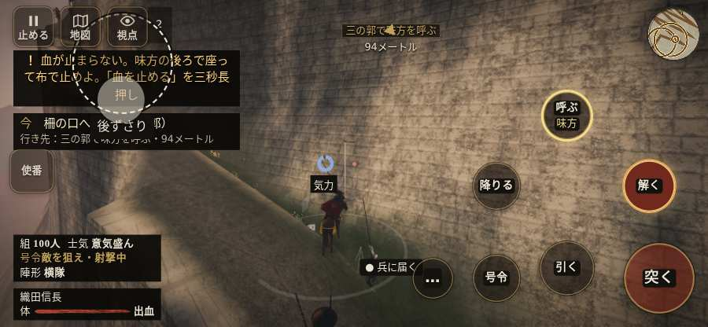

# テストプレイヤーの感想：歴史好きの大人

- 人：ミチオ（62歳・郷土史の会）（3286番）
- 変わり目：台詞を全部読む・iPhone 横 844×390・信長で出陣・速い・身分 少し上・問屋:買わない・一人称・感度 ふつう・止めない
- 時：2026/10/15 22:50:16（300秒かかった）
- 画面：iPhone の横向き 844×390・倍率3・指で触る操作（touch.js の釦・棒・なぞり）・画質 低
- 遊んだ戦：箕作城の戦い（信長で出陣）（試験の持ち時間で打ち切り）（失敗）
- 機械の混み具合：4（load average）

## ひとこと

> 箕作城（信長で出陣）（試験の持ち時間で打ち切り）を、一人称で歩いて見て回りました。務めは果たせませんでしたが、それより気になる所があります。「親指の棒（歩く）」を押そうとしたら、別の物に当たった。史実を知る者としては、ここは看過できません。数で勝る隊が、小勢に一方的に削られて崩れた。史実を知る者としては、ここは看過できません。行き先があるのに20秒動かない兵。史実を知る者としては、ここは看過できません。

## 見つけた問題（3件・困った順）

### 1. 数で勝る隊が、小勢に一方的に削られて崩れた
- どこで：箕作城の戦い（信長で出陣）・260秒・climb
- 何が：二の丸の槍と弓 損害が出始めた時12 対 戦った敵は最多1（15を失った）／城将の本陣 損害が出始めた時12 対 戦った敵は最多1（13を失った）
- どれくらい困ったか：★★ かなり困った（2回）
- 直し方の目安：兵の数の差が、削り合いと士気に効くようにする
- 画面：（その戦の山場の一枚）

### 2. 「親指の棒（歩く）」を押そうとしたら、別の物に当たった
- どこで：箕作城の戦い（信長で出陣）・39秒・climb
- 何が：指の下にあったのは #hud.battle-active.hudmin > #battle-notices > #objectives「任務の一覧を開く。残り 1件・済 0件・失敗 0件」
- どれくらい困ったか：★★ かなり困った（1回）
- 直し方の目安：重ねている札の置き場所をずらすか、pointer-events:none にする
- 画面：

### 3. 行き先があるのに20秒動かない兵
- どこで：箕作城の戦い（信長で出陣）・378秒・torch
- 何が：味方の丹羽長秀：味方の丹羽長秀（号令：attack・丹羽長秀の西の仕寄り・頭：無/―・近い敵40m）at (2,-60)
- どれくらい困ったか：★ 少し気になった（1回）
- 直し方の目安：道が塞がれていないか、行き先に着いたと見なせているかを見る
- 画面：（その戦の山場の一枚）

## 遊んだ記録

- 箕作城の戦い（信長で出陣）（試験の持ち時間で打ち切り）（戦の任務とは別に、試験全体の持ち時間が尽きた）：396秒・任務失敗・戦功45・組61/100・討ち取り8・突き20/当たり20・号令0回・指で押した数47・読み込み3.7秒・戦の前の札100字・1コマ30.2ms（実時間262秒・内訳 brain 0.2・pad 0.1・tf 0.7・upd 29.0・eye 0.2）
  - 任務の流れ：0s 藤吉郎の旗に続き、柵の口へ → 6s 柵の口へ進め（三の郭） → 130s 味方を呼べ（三の郭） → 281s あと13秒守れ（三の郭） → 282s あと12秒守れ（三の郭） → 283s あと11秒守れ（三の郭） → 284s あと10秒守れ（三の郭） → 285s あと9秒守れ（三の郭） → 286s あと8秒守れ（三の郭） → 287s あと7秒守れ（三の郭） → 288s あと6秒守れ（三の郭） → 289s あと5秒守れ（三の郭） → 290s あと4秒守れ（三の郭） → 291s あと3秒守れ（三の郭）
  - 味方の隊：隊15・動いた計4648m・味方の討ち取り95・敵を前に20秒止まった41回・本物の味方5人未満0秒
  - 受けた傷：足軽 37・侍 26
  - 開戦：
  - 山場：
