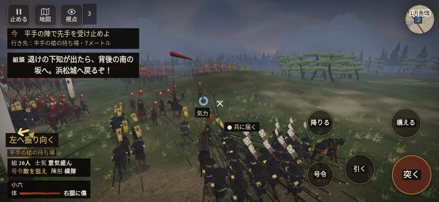

# テストプレイヤーの感想：アクション好き

- 人：ソウタ（24歳・アクションゲーム好き）（3372番）
- 変わり目：走りっぱなし・iPhone 横 932×430・織田家編の戦を一つ・ゆっくり・身分 少し上・問屋:馬・三人称・感度 敏感・途中で止める
- 時：2026/10/16 1:31:57（243秒かかった）
- 画面：iPhone の横向き 932×430・倍率3・指で触る操作（touch.js の釦・棒・なぞり）・画質 低
- 遊んだ戦：三方ヶ原の戦い（試験の持ち時間で打ち切り）（失敗・倒れた）
- 機械の混み具合：3（load average）

## ひとこと

> とにかく突っ込んだ。3分で1人斬った。7回突いて9回当たり。当たりはいい感じ。前へ進もうとしても進めない所があった、ストレスたまる。倒れて戦が終わった、ストレスたまる。斬り合う相手が少なくて退屈、もったいない。1回やられた。難しいのはいいけど、何でやられたか分かるようにしてほしい。

## 見つけた問題（5件・困った順）

### 1. 前へ進もうとしても進めない所があった
- どこで：三方ヶ原の戦い・34秒・first
- 何が：(23, -15)・段 first
- どれくらい困ったか：★★ かなり困った（1回）
- 直し方の目安：当たり（柵・建物・地形）と道のつながりを見直す
- 画面：

### 2. 倒れて戦が終わった
- どこで：三方ヶ原の戦い・215秒・crash
- 何が：208秒で倒れた（受けた傷：足軽 130・侍 23・騎馬 14）
- どれくらい困ったか：★★ かなり困った（1回）
- 直し方の目安：初めの戦は受ける傷を減らす・危ない時に字幕で構えを教える
- 画面：（その戦の山場の一枚）

### 3. HUD の札どうしが重なって読めない
- どこで：三方ヶ原の戦い・205秒・crash
- 何が：#mobfx と .mk.edge（932×430）／#mobfx と .bl（932×430）
- どれくらい困ったか：★ 少し気になった（8回）
- 直し方の目安：置き場所をずらすか、片方を出している間はもう片方を隠す
- 画面：（その戦の山場の一枚）

### 4. 押せる所が小さい（28px 未満）
- どこで：三方ヶ原の戦い・55秒・first
- 何が：#battle-notices > #objectives.goal-changed > #obj-list：264×20「「今」の任務を進めよう。」／#battle-notices > #objectives > #obj-list：264×20「「今」の任務を進めよう。」
- どれくらい困ったか：★ 少し気になった（5回）
- 直し方の目安：押せる大きさを 28px 以上に
- 画面：（その戦の山場の一枚）

### 5. 斬り合う相手が少なくて退屈
- どこで：三方ヶ原の戦い・215秒・crash
- 何が：3分で1人
- どれくらい困ったか：★ 少し気になった（1回）
- 画面：（その戦の山場の一枚）

## 遊んだ記録

- 三方ヶ原の戦い（試験の持ち時間で打ち切り）（戦の任務とは別に、試験全体の持ち時間が尽きた）：208秒・任務失敗（倒れた）・戦功90・組20/20・討ち取り1・突き7/当たり9・号令0回・指で押した数36・読み込み2.7秒・戦の前の札161字・1コマ39.1ms（実時間202秒・内訳 brain 0.1・pad 0.1・tf 0.4・upd 38.3・eye 0.2）
  - 任務の流れ：0s 平手の旗で槍をそろえよ → 29s 平手の陣で先手を受け止めよ → 54s 味方の槍の列をそろえ直せ → 60s 平手の陣を守り、下知を待て → 122s 右の森へ槍を向け直せ → 157s 味方と南の坂へ退け → 163s 佐久間の手と南の坂へ退け
  - 味方の隊：隊39・動いた計1661m・味方の討ち取り69・敵を前に20秒止まった18回・本物の味方5人未満0秒
  - 受けた傷：足軽 130・侍 23・騎馬 14
  - 開戦：
  - 山場：
