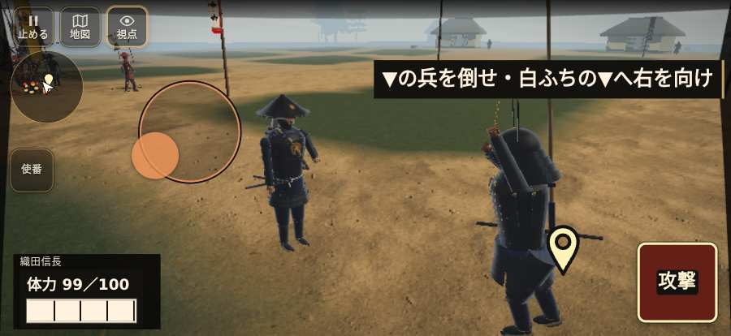

# テストプレイヤーの感想：アクション好き

- 人：ソウタ（24歳・アクションゲーム好き）（3837番）
- 変わり目：連打・iPhone 横 874×402・信長で出陣・ふつう・足軽から・問屋:鉄砲・一人称・感度 ふつう・止めない
- 時：2026/10/25 11:55:15（100秒かかった）
- 画面：iPhone の横向き 874×402・倍率3・指で触る操作（touch.js の釦・棒・なぞり）・画質 高
- 遊んだ戦：稲生の戦い（信長で出陣）（達成）
- 機械の混み具合：3（load average）

## ひとこと

> とにかく突っ込んだ。6分で12人斬った。410回突いて46回当たり。当たらなさすぎ。指の端末では「KeyF」ができない、もったいない。HUD の札どうしが重なって読めない、もったいない。「乗る」をしたいのに、押す丸が出ていない、手応えがスカスカ。もっと派手に、じゃなくて重く斬り合いたい。

## 見つけた問題（6件・困った順）

### 1. HUD の札どうしが重なって読めない
- どこで：稲生の戦い（信長で出陣）・5秒・brief
- 何が：.bl.hz-has-73 と .field-names（874×402）／#h-prog と .field-names（874×402）
- どれくらい困ったか：★★ かなり困った（250回）
- 直し方の目安：置き場所をずらすか、片方を出している間はもう片方を隠す
- 画面：（その戦の山場の一枚）

### 2. 戦場が札に食われている（画面の3分の1超）
- どこで：稲生の戦い（信長で出陣）・5秒・brief
- 何が：874×402 で 100%
- どれくらい困ったか：★★ かなり困った（76回）
- 直し方の目安：札を小さくするか、平時は薄く・畳む
- 画面：（その戦の山場の一枚）

### 3. 指の端末では「KeyF」ができない（押す丸が無い）
- どこで：稲生の戦い（信長で出陣）・7秒・brief
- 何が：bot の頭が KeyF を押したがった（稲生の戦い（信長で出陣）・7秒・brief）
- どれくらい困ったか：★★ かなり困った（43回）
- 直し方の目安：touch.js に釦を足すか、戦の方で要らなくする
- 画面：（その戦の山場の一枚）

### 4. 指の端末では「Digit1」ができない（押す丸が無い）
- どこで：稲生の戦い（信長で出陣）・2秒・brief
- 何が：bot の頭が Digit1 を押したがった（稲生の戦い（信長で出陣）・2秒・brief）
- どれくらい困ったか：★★ かなり困った（1回）
- 直し方の目安：touch.js に釦を足すか、戦の方で要らなくする
- 画面：（その戦の山場の一枚）

### 5. 突いても、なかなか当たらない
- どこで：稲生の戦い（信長で出陣）・381秒・end
- 何が：410回振り、門・柵に当たった振り0回、兵に当たった振り45回
- どれくらい困ったか：★★ かなり困った（1回）
- 直し方の目安：狙いの補助と、敵まで通れる道・間合いを確かめる
- 画面：（その戦の山場の一枚）

### 6. 「乗る」をしたいのに、押す丸が出ていない
- どこで：稲生の戦い（信長で出陣）・29秒・practice
- 何が：欲しかった時：稲生の戦い（信長で出陣）・29秒・practice
- どれくらい困ったか：★ 少し気になった（52回）
- 直し方の目安：その時に使える釦は出す（touchFrame の出し入れ）
- 画面：（その戦の山場の一枚）

## 遊んだ記録

- 稲生の戦い（信長で出陣）：381秒・任務達成・戦功208・組—・討ち取り12・突き410/当たり46・号令0回・指で押した数2651・読み込み5.5秒・戦の前の札0字・1コマ8.8ms（実時間83秒・内訳 brain 0.1・pad 0.3・tf 0.2・upd 8.1・eye 0.1）
  - 任務の流れ：0s 赤い▼の兵を倒せ → 46s 赤い▼の林美作守の兵を倒せ → 85s 赤い▼の隊長を倒せ → 95s 信長の旗で、来た敵を止めよう → 120s 味方が正面を押さえる間に、右の畦へ回ろう → 208s 信長と列を立て直し、林の備を崩そう → 238s 味方と攻め、林美作守の備を崩そう → 300s 味方と追撃し、柴田の槍隊には近づきすぎない → 311s 深追いせず、柴田隊が退くのを見届けよう → 381s 深追いせず、柴田隊が退くのを見届けよう〔済〕
  - 味方の隊：隊21・動いた計2758m・味方の討ち取り99・敵を前に20秒止まった2回・本物の味方5人未満0秒
  - 受けた傷：足軽 1
  - 開戦：
  - 山場：
  - 勝ち負けが決まった所：
