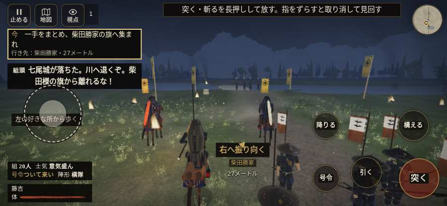

# テストプレイヤーの感想：歴史好きの大人

- 人：ミチオ（62歳・郷土史の会）（4301番）
- 変わり目：迷子になりやすい・iPhone 横 932×430・織田家編の戦を一つ・ふつう・身分 上・問屋:買わない・三人称・感度 ふつう・途中で止める
- 時：2026/10/16 21:16:26（241秒かかった）
- 画面：iPhone の横向き 932×430・倍率3・指で触る操作（touch.js の釦・棒・なぞり）・画質 低
- 遊んだ戦：手取川の戦い（失敗）
- 機械の混み具合：2（load average）

## ひとこと

> 手取川を、一人称で歩いて見て回りました。務めは果たせませんでしたが、それより気になる所があります。「親指の棒（歩く）」を押そうとしたら、別の物に当たった。当時の人が見たら首を傾げるでしょう。前へ進もうとしても進めない所があった。当時の人が見たら首を傾げるでしょう。行き先があるのに20秒動かない兵。細かい事ですが、こういう所で嘘っぽくなる。

## 見つけた問題（4件・困った順）

### 1. 行き先があるのに20秒動かない兵
- どこで：手取川の戦い・67秒・rear
- 何が：味方の丹羽長秀：味方の丹羽長秀（号令：path・丹羽長秀の手・頭：無/―・近い敵45m）at (-30,-60)／味方の丹羽長秀：味方の丹羽長秀（号令：path・丹羽長秀の手・頭：無/―・近い敵27m）at (-30,-60)
- どれくらい困ったか：★★★ やめたくなった（4回）
- 直し方の目安：道が塞がれていないか、行き先に着いたと見なせているかを見る
- 画面：（その戦の山場の一枚）

### 2. 「親指の棒（歩く）」を押そうとしたら、別の物に当たった
- どこで：手取川の戦い・0秒・brief
- 何が：指の下にあったのは #battle-notices > #battle-message > #subtitle「組頭七尾城が落ちた。川へ退く」
- どれくらい困ったか：★★ かなり困った（1回）
- 直し方の目安：重ねている札の置き場所をずらすか、pointer-events:none にする
- 画面：

### 3. 前へ進もうとしても進めない所があった
- どこで：手取川の戦い・41秒・retreat
- 何が：(1, -73)・段 retreat
- どれくらい困ったか：★★ かなり困った（1回）
- 直し方の目安：当たり（柵・建物・地形）と道のつながりを見直す
- 画面：

### 4. 戦う兵が遠景の大軍（影の兵）の中に埋もれている
- どこで：手取川の戦い・66秒・rear
- 何が：味方の兵 4人が、遠景の大軍 #1（中心 6,-63・27人）の中（5, -58）
- どれくらい困ったか：★ 少し気になった（1回）
- 直し方の目安：遠景の大軍を戦う場所から離す（addDistantArmy の x,z,w,d を見直す）か、兵の行き先を大軍の外にする
- 画面：（その戦の山場の一枚）

## 遊んだ記録

- 手取川の戦い：228秒・任務失敗・戦功10・組20/20・討ち取り0・突き0/当たり0・号令0回・指で押した数7・読み込み3.3秒・戦の前の札138字・1コマ34.2ms（実時間203秒・内訳 brain 0.2・pad 0.1・tf 0.5・upd 33.2・eye 0.2）
  - 任務の流れ：0s 一手をまとめ、柴田勝家の旗へ集まれ → 22s 組頭に続き、北岸の火へ退け → 65s 一手を率い、北岸で追手を止めよ／旗のそばで、北の追手を止めよ → 89s 一手を率い、北岸で追手を止めよ／北岸の火で、組と次の追手を止めよ → 117s 一手を率い、北岸で追手を止めよ／組と前へ出て、追手を押し返せ → 228s 一手を率い、北岸で追手を止めよ〔失〕
  - 味方の隊：隊19・動いた計1189m・味方の討ち取り24・敵を前に20秒止まった44回・本物の味方5人未満0秒
  - 受けた傷：足軽 22・侍 21
  - 開戦：
