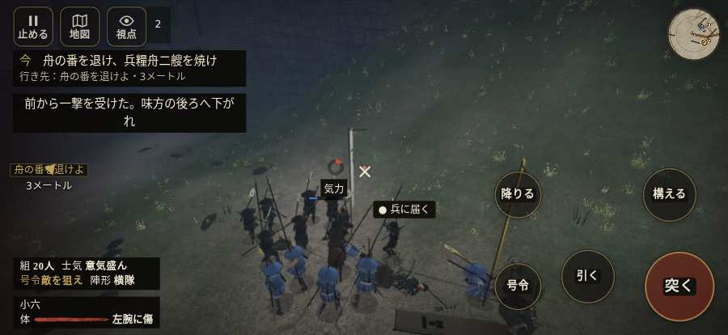

# テストプレイヤーの感想：はじめての中学生

- 人：ハルト（13歳・中学一年）（4380番）
- 変わり目：台詞を全部読む・iPhone 横 874×402・新しく始める通し・ゆっくり・身分 上・問屋:供・三人称・感度 鈍い・止めない
- 時：2026/10/16 23:38:16（199秒かかった）
- 画面：iPhone の横向き 874×402・倍率3・指で触る操作（touch.js の釦・棒・なぞり）・画質 低
- 遊んだ戦：鳥取城の戦い（失敗・倒れた）
- 機械の混み具合：4（load average）

## ひとこと

> 友だちにすすめられて、やってみた。鳥取城をやった。よく分かんないまま終わった。1回すぐ死んだ…。「HUD の札どうしが重なって読めない」のとこ、マジで意味わかんない。「前へ進もうとしても進めない所があった」のとこ、ふつうに困った。「「親指の棒（歩く）」を押そうとしたら、別の物に当たった」のとこ、だるい。ぶっちゃけ、ここで一回やめかけた。

## 見つけた問題（8件・困った順）

### 1. HUD の札どうしが重なって読めない
- どこで：鳥取城の戦い・40秒・boats
- 何が：#mobfx と .mk.edge（874×402）／#mobfx と .bl（874×402）
- どれくらい困ったか：★★★ やめたくなった（24回）
- 直し方の目安：置き場所をずらすか、片方を出している間はもう片方を隠す
- 画面：（その戦の山場の一枚）

### 2. 戦場が札に食われている（画面の3分の1超）
- どこで：鳥取城の戦い・40秒・boats
- 何が：874×402 で 100%
- どれくらい困ったか：★★★ やめたくなった（3回）
- 直し方の目安：札を小さくするか、平時は薄く・畳む
- 画面：（その戦の山場の一枚）

### 3. 字と背景の明暗の比が低い（3 未満）
- どこで：鳥取城の戦い・戦のあと
- 何が：.zk-toast > div > small：2.3「実績を得た」／.zk-toast > div > b：1.1「初陣」
- どれくらい困ったか：★★★ やめたくなった（3回）
- 直し方の目安：字を明るく、または背景を暗く
- 画面：（その戦の山場の一枚）

### 4. 前へ進もうとしても進めない所があった
- どこで：鳥取城の戦い・33秒・boats
- 何が：(-46, -14)・段 boats
- どれくらい困ったか：★★ かなり困った（2回）
- 直し方の目安：当たり（柵・建物・地形）と道のつながりを見直す
- 画面：

### 5. 「親指の棒（歩く）」を押そうとしたら、別の物に当たった
- どこで：鳥取城の戦い・139秒・boats
- 何が：指の下にあったのは #battle-notices > #battle-message > #subtitle「組頭よし、一艘の荷は止めた。」
- どれくらい困ったか：★★ かなり困った（1回）
- 直し方の目安：重ねている札の置き場所をずらすか、pointer-events:none にする
- 画面：（その戦の山場の一枚）

### 6. 前へ進もうとしても進めない所があった
- どこで：鳥取城の戦い・203秒・sortie
- 何が：(-61, -8)・段 sortie
- どれくらい困ったか：★★ かなり困った（1回）
- 直し方の目安：当たり（柵・建物・地形）と道のつながりを見直す
- 画面：（その戦の山場の一枚）

### 7. すぐに倒れてしまった
- どこで：鳥取城の戦い・227秒・sortie
- 何が：210秒で倒れた（受けた傷：足軽 96・侍 43）
- どれくらい困ったか：★ 少し気になった（1回）
- 直し方の目安：初めの戦は受ける傷を減らす・危ない時に字幕で構えを教える
- 画面：（その戦の山場の一枚）

### 8. 押せる所が小さい（28px 未満）
- どこで：鳥取城の戦い・開戦
- 何が：#battle-notices > #objectives > #obj-list：264×20「「今」の任務を進めよう。」
- どれくらい困ったか：★ 少し気になった（1回）
- 直し方の目安：押せる大きさを 28px 以上に
- 画面：（その戦の山場の一枚）

## 遊んだ記録

- 鳥取城の戦い：210秒・任務失敗（倒れた）・戦功65・組19/20・討ち取り13・突き163/当たり44・号令0回・指で押した数346・読み込み4.3秒・戦の前の札154字・1コマ25.8ms（実時間147秒・内訳 brain 0.1・pad 0.5・tf 0.3・upd 24.8・eye 0.1）
  - 任務の流れ：0s 川岸の組へ進み、一手をそろえよ → 2s 舟の番を退け、兵糧舟二艘を焼け → 194s 一手を率い、柵で城兵を止めよ
  - 味方の隊：隊17・動いた計357m・味方の討ち取り6・敵を前に20秒止まった48回・本物の味方5人未満0秒
  - 受けた傷：足軽 96・侍 43
  - 開戦：
  - 山場：
