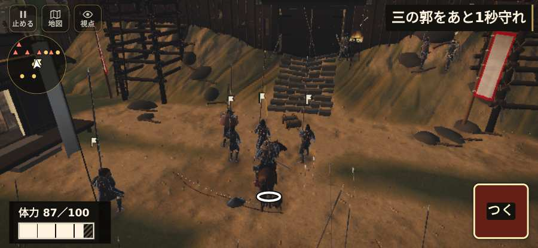

# テストプレイヤーの感想：歴史好きの大人

- 人：ミチオ（62歳・郷土史の会）（4771番）
- 変わり目：連打・iPhone 横 932×430・織田家編の戦を一つ・ふつう・足軽から・問屋:供・三人称・感度 ふつう・止めない
- 時：2026/10/26 6:22:24（227秒かかった）
- 画面：iPhone の横向き 932×430・倍率3・指で触る操作（touch.js の釦・棒・なぞり）・画質 高
- 遊んだ戦：箕作城の戦い（試験の持ち時間で打ち切り）（失敗）
- 機械の混み具合：1（load average）

## ひとこと

> 箕作城（試験の持ち時間で打ち切り）を、一人称で歩いて見て回りました。務めは果たせませんでしたが、それより気になる所があります。遊んでいる途中でゲームが落ちた。当時の人が見たら首を傾げるでしょう。行き先があるのに20秒動かない兵。当時の人が見たら首を傾げるでしょう。

## 見つけた問題（2件・困った順）

### 1. 行き先があるのに20秒動かない兵
- どこで：箕作城の戦い・45秒・torch
- 何が：味方の足軽：味方の足軽（号令：move・佐久間信盛の大手の控え・頭：無/―・近い敵45m逃）at (7,-17)／味方の足軽：味方の足軽（号令：move・佐久間信盛の大手の控え・頭：無/―・近い敵45m逃）at (3,-17)
- どれくらい困ったか：★★★ やめたくなった（10回）
- 直し方の目安：道が塞がれていないか、行き先に着いたと見なせているかを見る
- 画面：（その戦の山場の一枚）

### 2. 遊んでいる途中でゲームが落ちた（例外）
- どこで：箕作城の戦い・87秒・torch
- 何が：Uncaught TypeError: Cannot read properties of null (reading 'mounted')（humans_bounds.js:11）
- どれくらい困ったか：★★★ やめたくなった（1回）
- 直し方の目安：この行の前提（値が無い・死んだ兵など）を確かめる
- 画面：（その戦の山場の一枚）

## 遊んだ記録

- 箕作城の戦い（試験の持ち時間で打ち切り）（戦の任務とは別に、試験全体の持ち時間が尽きた）：87秒・任務失敗・戦功20・組18/20・討ち取り1・突き3/当たり2・号令0回・指で押した数4・読み込み19.6秒・戦の前の札144字・1コマ26.9ms（実時間188秒・内訳 brain 0.3・pad 0.2・tf 0.4・upd 25.8・eye 0.2）
  - 任務の流れ：0s 旗に続き、柵の口へ → 6s 味方を呼び、柵の口へ → 27s 三の郭をあと13秒守れ → 28s 三の郭をあと12秒守れ → 29s 三の郭をあと11秒守れ → 30s 三の郭をあと10秒守れ → 31s 三の郭をあと9秒守れ → 32s 三の郭をあと8秒守れ → 33s 三の郭をあと7秒守れ → 34s 三の郭をあと6秒守れ → 35s 三の郭をあと5秒守れ → 36s 三の郭をあと4秒守れ → 37s 三の郭をあと3秒守れ → 38s 三の郭をあと2秒守れ
  - 味方の隊：隊13・動いた計577m・味方の討ち取り19・敵を前に20秒止まった5回・本物の味方5人未満0秒
  - 受けた傷：足軽 15・弓 9
  - 不具合：Uncaught TypeError: Cannot read properties of null (reading 'mounted')（humans_bounds.js:11）
  - 開戦：
  - 山場：
