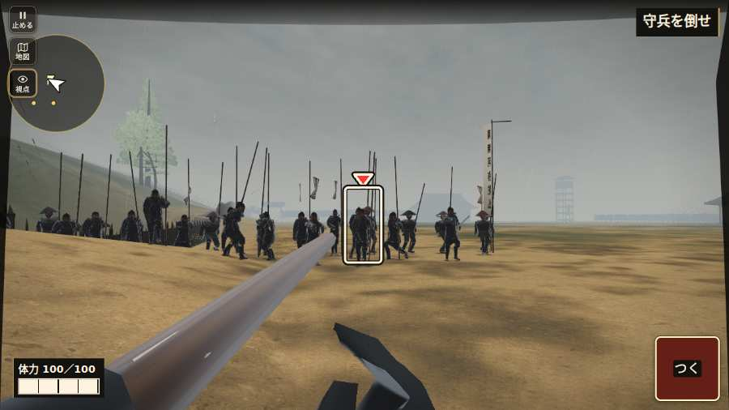

# テストプレイヤーの感想：せっかちな社会人

- 人：ユウキ（35歳・昼休みに遊ぶ会社員）（4809番）
- 変わり目：構え多め・パソコン 1280×720・新しく始める通し・速い・身分 中ほど・問屋:馬・一人称・感度 鈍い・途中で止める
- 時：2026/10/26 6:34:24（247秒かかった）
- 画面：パソコン 1280×720・鍵盤とマウス・画質 高
- 遊んだ戦：越前一向一揆・木ノ芽峠（失敗）
- 機械の混み具合：0（load average）

## ひとこと

> 昼休みに2分ほど。越前一向一揆・木ノ芽峠。遊んでいる途中でゲームが落ちた。ここで閉じる人は多いと思う。戦のあと、城下へ進めなかった。時間がもったいない。戦が始まるまでの読み込みが長い。待ってられない。読み込みも16秒待たされた。結局、何分遊べば一区切りなのかが分からない。

## 見つけた問題（4件・困った順）

### 1. 遊んでいる途中でゲームが落ちた（例外）
- どこで：越前一向一揆・木ノ芽峠・127秒・kannon
- 何が：TypeError: el._groundRing.setAttribute is not a function     at drawGroundDestination (http://localhost:8765/v202610252305/src/mission_pin.js:982:18)     at drawMissionPin (http://localhost:8765/v202610252305/src/mission_pin.js:352:5)
- どれくらい困ったか：★★★ やめたくなった（1回）
- 直し方の目安：この行の前提（値が無い・死んだ兵など）を確かめる
- 画面：（その戦の山場の一枚）

### 2. 戦のあと、城下へ進めなかった
- どこで：越前・大滝寺の夜討ちの前・城下
- 何が：戦のあとの画面で釦を押し続けても、城下の札が出ない（画面なし）
- どれくらい困ったか：★★★ やめたくなった（1回）
- 直し方の目安：戦のあとの画面に、はっきりした「次へ（城下へ）」を置く
- 画面：（その戦の山場の一枚）

### 3. 戦が始まるまでの読み込みが長い
- どこで：越前一向一揆・木ノ芽峠
- 何が：越前一向一揆・木ノ芽峠：押してから 15.7秒（機械が混んでいる時の値）
- どれくらい困ったか：★★ かなり困った（1回）
- 直し方の目安：読み込みの間に、戦の心得を読ませる／重い物を後から足す
- 画面：（その戦の山場の一枚）

### 4. 号令「follow」が、指の号令の輪から出せない
- どこで：越前一向一揆・木ノ芽峠・91秒・kannon
- 何が：号令の輪（RADIAL）に無い、または身分が足りず選べない（越前一向一揆・木ノ芽峠・91秒・kannon）
- どれくらい困ったか：★ 少し気になった（7回）
- 直し方の目安：号令の輪に足すか、短く押した時の指揮の札（数字の号令）を指で押せるようにする
- 画面：（その戦の山場の一枚）

## 遊んだ記録

- 越前一向一揆・木ノ芽峠：127秒・任務失敗・戦功45・組18/20・討ち取り3・突き63/当たり9・号令4回・指で押した数219・読み込み15.7秒・戦の前の札165字・1コマ16.2ms（実時間58秒・内訳 brain 0.3・pad 0.1・tf 0.2・upd 15.5・eye 0.1）
  - 任務の流れ：0s 味方のそばで構え、門外の小勢を受けよ → 62s 懸かり太鼓。木戸を通り、味方と守兵を崩せ → 62s 観音丸の中へ。開いた口を通れ → 63s 観音丸の中の守兵を崩せ（残り24人） → 78s 観音丸の中の守兵を崩せ（残り23人） → 85s 観音丸の中の守兵を崩せ（残り22人） → 87s 観音丸の中の守兵を崩せ（残り21人） → 92s 観音丸の中の守兵を崩せ（残り20人） → 93s 観音丸の中の守兵を崩せ（残り19人） → 96s 観音丸の中の守兵を崩せ（残り18人） → 97s 観音丸の中の守兵を崩せ（残り17人） → 98s 観音丸の中の守兵を崩せ（残り11人） → 98s 観音丸の中の守兵を崩せ（残り8人） → 98s 観音丸の中の守兵を崩せ（残り7人）
  - 味方の隊：隊12・動いた計1182m・味方の討ち取り10・敵を前に20秒止まった8回・本物の味方5人未満0秒
  - 受けた傷：足軽 64
  - 不具合：TypeError: el._groundRing.setAttribute is not a function     at drawGroundDestination (http://localhost:8765/v202610252305/src/mission_pin.js:982:18)     at drawMissionPin (http://localhost:8765/v202610252305/src/mission_pin.js:352:5)
  - 開戦：
  - 山場：
  - 終わり近く：
