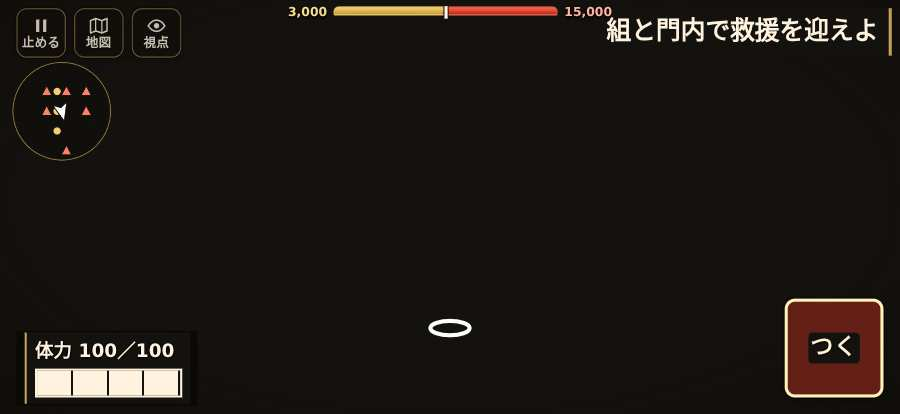

# テストプレイヤーの感想：歴史好きの大人

- 人：ミチオ（62歳・郷土史の会）（5111番）
- 変わり目：連打・iPhone 横 874×402・織田家編の戦を一つ・速い・身分 中ほど・問屋:買わない・三人称・感度 鈍い・途中で止める
- 時：2026/10/26 14:20:10（167秒かかった）
- 画面：iPhone の横向き 874×402・倍率3・指で触る操作（touch.js の釦・棒・なぞり）・画質 高
- 遊んだ戦：天王寺の戦い（失敗・倒れた）
- 機械の混み具合：2（load average）

## ひとこと

> 天王寺を、一人称で歩いて見て回りました。務めは果たせませんでしたが、それより気になる所があります。号令「follow」が、指の号令の輪から出せない。当時の人が見たら首を傾げるでしょう。敵が近いのに、まわりの兵の多くが棒立ち。これでは興が醒めます。号令「槍衾」が、指の号令の輪から出せない。史実を知る者としては、ここは看過できません。

## 見つけた問題（6件・困った順）

### 1. 敵が近いのに、まわりの兵の多くが棒立ち
- どこで：天王寺の戦い・480秒・chase
- 何が：480秒：まわり35mの7人のうち3人が止まったまま（段 chase）
- どれくらい困ったか：★★ かなり困った（1回）
- 直し方の目安：敵が30m内に入ったら、構える・にじり寄る・槍を揃えるなど体を動かす
- 画面：（その戦の山場の一枚）

### 2. 号令「follow」が、指の号令の輪から出せない
- どこで：天王寺の戦い・39秒・break
- 何が：号令の輪（RADIAL）に無い、または身分が足りず選べない（天王寺の戦い・39秒・break）
- どれくらい困ったか：★ 少し気になった（8回）
- 直し方の目安：号令の輪に足すか、短く押した時の指揮の札（数字の号令）を指で押せるようにする
- 画面：（その戦の山場の一枚）

### 3. console.error：THREE.Object3D.add: object not an instance of THREE.Object3D.
- どこで：天王寺の戦い・戦の前の札
- 何が：—
- どれくらい困ったか：★ 少し気になった（3回）
- 直し方の目安：出どころを突き止める
- 画面：（その戦の山場の一枚）

### 4. 号令「槍衾」が、指の号令の輪から出せない
- どこで：天王寺の戦い・2秒・brief
- 何が：号令の輪（RADIAL）に無い、または身分が足りず選べない（天王寺の戦い・2秒・brief）
- どれくらい困ったか：★ 少し気になった（2回）
- 直し方の目安：号令の輪に足すか、短く押した時の指揮の札（数字の号令）を指で押せるようにする
- 画面：（その戦の山場の一枚）

### 5. 号令「続け」を出したが、組の多くが戦列を離れている
- どこで：天王寺の戦い・440秒・chase
- 何が：9人のうち逃亡・負傷で動けない兵は9人（天王寺の戦い・440秒・chase）
- どれくらい困ったか：★ 少し気になった（2回）
- 直し方の目安：組が崩れた理由を確かめ、旗のそばで退避と立て直しを行う
- 画面：（その戦の山場の一枚）

### 6. 倒れて戦が終わった
- どこで：天王寺の戦い・484秒・chase
- 何が：480秒で倒れた（受けた傷：足軽 142｜段 chase・最後の傷 273s足軽20→110距2.1見undefined 275s足軽17→105囲距0.7見undefined 275s足軽22→83囲距2.0見undefined 404s足軽18→60囲距0.6見undefined 442s足軽25→35背囲距4.3見undefined 482s足軽18→30背退距1.9見6.7 484s足軽21→6退距2.5見6.7｜跡 443:4:31,-78,6:30:thrust 446:4:27,-68,6:30:thrust 449:4:26,-60,7:30:thrust 452:4:26,-54,7:30:thrust 455:4:20,-47,7:30:thrust 458:4:14,-40,7:30:thrust 461:4:9,-32,7:30:thrust 464:4:7,-28,7:30:thrust 467:4:7,-28,7:30:thrust 470:4:7,-28,7:30:thrust 473:4:4,-26,7:30:thrust 476:4:5,-26,7:30:thrust 479:4:-2,-26,7:30:thrust 482:4:-7,-20,7:30:thrust）
- どれくらい困ったか：★ 少し気になった（1回）
- 直し方の目安：初めの戦は受ける傷を減らす・危ない時に字幕で構えを教える
- 画面：（その戦の山場の一枚）

## 遊んだ記録

- 天王寺の戦い：480秒・任務失敗（倒れた）・戦功71・組—・討ち取り1・突き4/当たり5・号令9回・指で押した数9・読み込み13.8秒・戦の前の札139字・1コマ13ms（実時間139秒・内訳 brain 0.1・pad 0.1・tf 0.3・upd 12.3・eye 0.1）
  - 任務の流れ：0s 組と南の門内を守れ → 8s 南の門内を守れ → 39s 組と門内で救援を迎えよ → 98s 南の門内の脇で、信長の入城を迎えよ → 121s 南の門内で組をそろえ、下知を待て → 133s 組を率い、砦の東を回って北の敵を崩せ → 281s 組を率い、退く敵を城戸口まで追え → 480s 組を率い、退く敵を城戸口まで追え〔失〕
  - 味方の隊：隊16・動いた計5438m・味方の討ち取り83・敵を前に20秒止まった34回・本物の味方5人未満0秒
  - 受けた傷：足軽 142｜段 chase・最後の傷 273s足軽20→110距2.1見undefined 275s足軽17→105囲距0.7見undefined 275s足軽22→83囲距2.0見undefined 404s足軽18→60囲距0.6見undefined 442s足軽25→35背囲距4.3見undefined 482s足軽18→30背退距1.9見6.7 484s足軽21→6退距2.5見6.7｜跡 443:4:31,-78,6:30:thrust 446:4:27,-68,6:30:thrust 449:4:26,-60,7:30:thrust 452:4:26,-54,7:30:thrust 455:4:20,-47,7:30:thrust 458:4:14,-40,7:30:thrust 461:4:9,-32,7:30:thrust 464:4:7,-28,7:30:thrust 467:4:7,-28,7:30:thrust 470:4:7,-28,7:30:thrust 473:4:4,-26,7:30:thrust 476:4:5,-26,7:30:thrust 479:4:-2,-26,7:30:thrust 482:4:-7,-20,7:30:thrust
  - 開戦：
  - 山場：
  - 一人称で見回す（107秒）：
