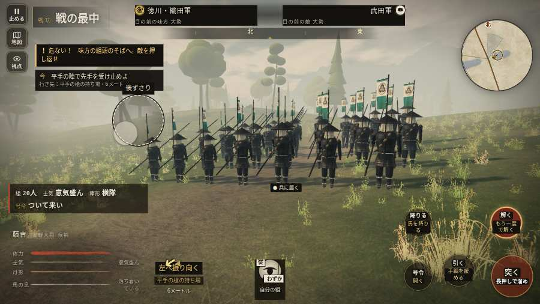

# テストプレイヤーの感想：歴史好きの大人

- 人：ミチオ（62歳・郷土史の会）（6126番）
- 変わり目：連打・パソコン 1280×720・織田家編の戦を一つ・ゆっくり・身分 少し上・問屋:買わない・三人称・感度 敏感・止めない
- 時：2026/10/18 6:24:13（305秒かかった）
- 画面：パソコン 1280×720・鍵盤とマウス・画質 低
- 遊んだ戦：三方ヶ原の戦い（失敗・倒れた）
- 機械の混み具合：4（load average）

## ひとこと

> 三方ヶ原を、一人称で歩いて見て回りました。務めは果たせませんでしたが、それより気になる所があります。名のある武将なのに、顔も装束も並の侍と同じ。これでは興が醒めます。倒れて戦が終わった。細かい事ですが、こういう所で嘘っぽくなる。戦う兵が遠景の大軍（影の兵）の中に埋もれている。当時の人が見たら首を傾げるでしょう。

## 見つけた問題（5件・困った順）

### 1. 名のある武将なのに、顔も装束も並の侍と同じ
- どこで：三方ヶ原の戦い・5秒・brief
- 何が：水野信元（味方）
- どれくらい困ったか：★ 少し気になった（37回）
- 直し方の目安：units.js の GENERALS に顔・甲冑・兜を足す
- 画面：（その戦の山場の一枚）

### 2. 名のある武将なのに、顔も装束も並の侍と同じ
- どこで：三方ヶ原の戦い・5秒・brief
- 何が：長谷川橋介（味方）
- どれくらい困ったか：★ 少し気になった（35回）
- 直し方の目安：units.js の GENERALS に顔・甲冑・兜を足す
- 画面：（その戦の山場の一枚）

### 3. 名のある武将なのに、顔も装束も並の侍と同じ
- どこで：三方ヶ原の戦い・5秒・brief
- 何が：佐脇藤八（味方）
- どれくらい困ったか：★ 少し気になった（31回）
- 直し方の目安：units.js の GENERALS に顔・甲冑・兜を足す
- 画面：（その戦の山場の一枚）

### 4. 倒れて戦が終わった
- どこで：三方ヶ原の戦い・227秒・crash
- 何が：211秒で倒れた（受けた傷：足軽 195・侍 15・騎馬 5）
- どれくらい困ったか：★ 少し気になった（1回）
- 直し方の目安：初めの戦は受ける傷を減らす・危ない時に字幕で構えを教える
- 画面：（その戦の山場の一枚）

### 5. 戦う兵が遠景の大軍（影の兵）の中に埋もれている
- どこで：三方ヶ原の戦い・76秒・first
- 何が：敵の兵 9人が、遠景の大軍 #8（中心 20,-60・160人）の中（25, -62）
- どれくらい困ったか：★ 少し気になった（1回）
- 直し方の目安：遠景の大軍を戦う場所から離す（addDistantArmy の x,z,w,d を見直す）か、兵の行き先を大軍の外にする
- 画面：（その戦の山場の一枚）

## 遊んだ記録

- 三方ヶ原の戦い：211秒・任務失敗（倒れた）・戦功20・組7/20・討ち取り3・突き9/当たり8・号令0回・指で押した数24・読み込み4.4秒・戦の前の札184字・1コマ40.4ms（実時間239秒・内訳 brain 0.1・pad 0.1・tf 0.3・upd 39.6・eye 0.3）
  - 任務の流れ：0s 平手の旗で槍をそろえよ → 29s 平手の陣で先手を受け止めよ → 50s 味方の槍の列をそろえ直せ → 56s 平手の陣を守り、下知を待て → 118s 右の森へ槍を向け直せ → 159s 味方と南の坂へ退け → 165s 佐久間の手と南の坂へ退け
  - 味方の隊：隊37・動いた計1332m・味方の討ち取り57・敵を前に20秒止まった16回・本物の味方5人未満0秒
  - 受けた傷：足軽 195・侍 15・騎馬 5
  - 開戦：
  - 山場：
  - 一人称で見回す（61秒）：
