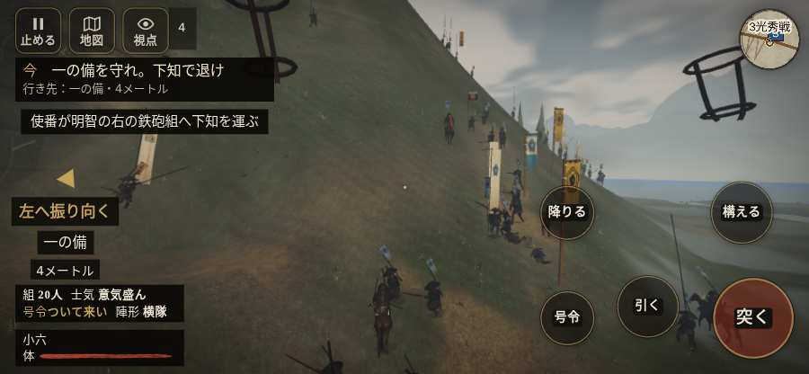

# テストプレイヤーの感想：歴史好きの大人

- 人：ミチオ（62歳・郷土史の会）（7731番）
- 変わり目：走りっぱなし・iPhone 横 844×390・織田家編の戦を一つ・ゆっくり・足軽から・問屋:刀・槍・具足・三人称・感度 敏感・途中で止める
- 時：2026/10/19 15:41:16（113秒かかった）
- 画面：iPhone の横向き 844×390・倍率3・指で触る操作（touch.js の釦・棒・なぞり）・画質 低
- 遊んだ戦：金ヶ崎の退き口（失敗）
- 機械の混み具合：2（load average）

## ひとこと

> 金ヶ崎の退き口を、一人称で歩いて見て回りました。務めは果たせませんでしたが、それより気になる所があります。「親指の棒（歩く）」を押そうとしたら、別の物に当たった。細かい事ですが、こういう所で嘘っぽくなる。味方が味方を傷つけている。当時の人が見たら首を傾げるでしょう。

## 見つけた問題（2件・困った順）

### 1. 味方が味方を傷つけている
- どこで：金ヶ崎の退き口・11秒・l1
- 何が：味方の鉄砲：味方の鉄砲 → 味方の鉄砲（15）／味方の鉄砲：味方の鉄砲 → 味方の鉄砲（26）
- どれくらい困ったか：★★★ やめたくなった（5回）
- 直し方の目安：狙いの相手を選ぶときに、同じ側を外す
- 画面：（その戦の山場の一枚）

### 2. 「親指の棒（歩く）」を押そうとしたら、別の物に当たった
- どこで：金ヶ崎の退き口・59秒・l1
- 何が：指の下にあったのは #battle-notices > #battle-message > #subtitle「弥助一番槍は我らの組ぞ！」
- どれくらい困ったか：★★ かなり困った（1回）
- 直し方の目安：重ねている札の置き場所をずらすか、pointer-events:none にする
- 画面：（その戦の山場の一枚）

## 遊んだ記録

- 金ヶ崎の退き口：172秒・任務失敗・戦功20・組19/20・討ち取り3・突き7/当たり8・号令0回・指で押した数14・読み込み8.2秒・戦の前の札137字・1コマ16.1ms（実時間82秒・内訳 brain 0.0・pad 0.1・tf 0.2・upd 15.7・eye 0.1）
  - 任務の流れ：0s 主力が退くまで、一手で追手を止めよ → 37s 一の備を守れ。下知で退け → 82s 味方と次の備へ退け。斬り合いに残るな → 172s 味方と次の備へ退け。斬り合いに残るな〔失〕
  - 味方の隊：隊11・動いた計769m・味方の討ち取り10・敵を前に20秒止まった30回・本物の味方5人未満0秒
  - 受けた傷：足軽 6
  - 開戦：
  - 一人称で見回す（45秒）：
  - 山場：
