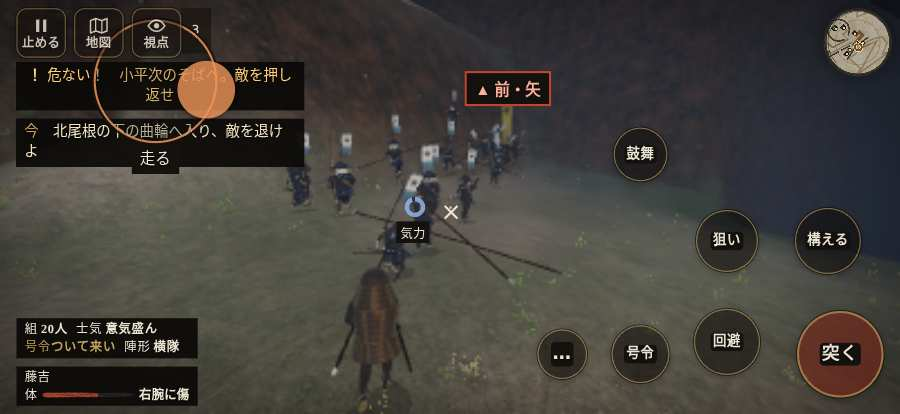

# テストプレイヤーの感想：アクション好き

- 人：ソウタ（24歳・アクションゲーム好き）（8632番）
- 変わり目：連打・iPhone 横 874×402・新しく始める通し・ゆっくり・身分 上・問屋:馬・三人称・感度 敏感・止めない
- 時：2026/10/20 17:18:38（298秒かかった）
- 画面：iPhone の横向き 874×402・倍率3・指で触る操作（touch.js の釦・棒・なぞり）・画質 低
- 遊んだ戦：信貴山城の戦い（達成）
- 機械の混み具合：2（load average）

## ひとこと

> とにかく突っ込んだ。5分で5人斬った。25回突いて25回当たり。当たりはいい感じ。押せる所が小さい、手応えがスカスカ。「親指の棒（歩く）」を押そうとしたら、別の物に当たった、もったいない。console.error：THREE.WebGLProgram: Shader Error 1282 - VALIDATE_STATUS false

Program Info Log:、ストレスたまる。もっと派手に、じゃなくて重く斬り合いたい。

## 見つけた問題（6件・困った順）

### 1. 押せる所が小さい（28px 未満）
- どこで：信貴山城の戦い・開戦
- 何が：#battle-notices > #objectives.goal-changed > #obj-list：264×20「「今」の任務を進めよう。」／#battle-notices > #objectives > #obj-list：264×20「「今」の任務を進めよう。」
- どれくらい困ったか：★★ かなり困った（36回）
- 直し方の目安：押せる大きさを 28px 以上に
- 画面：（その戦の山場の一枚）

### 2. console.error：THREE.WebGLProgram: Shader Error 1282 - VALIDATE_STATUS false

Program Info Log:
- どこで：信貴山城の戦い・開戦
- 何が：—
- どれくらい困ったか：★★ かなり困った（8回）
- 直し方の目安：出どころを突き止める
- 画面：（その戦の山場の一枚）

### 3. 「親指の棒（歩く）」を押そうとしたら、別の物に当たった
- どこで：信貴山城の戦い・115秒・interior
- 何が：指の下にあったのは #hud.battle-active.shigisan-notices > #battle-notices > #objectives「任務の一覧を開く。残り 1件・済 0件・失敗 0件」
- どれくらい困ったか：★★ かなり困った（1回）
- 直し方の目安：重ねている札の置き場所をずらすか、pointer-events:none にする
- 画面：

### 4. HUD の札どうしが重なって読めない
- どこで：信貴山城の戦い・50秒・climb
- 何が：#aimwarn と .bl（874×402）／#aimwarn と #minimap（874×402）
- どれくらい困ったか：★ 少し気になった（6回）
- 直し方の目安：置き場所をずらすか、片方を出している間はもう片方を隠す
- 画面：（その戦の山場の一枚）

### 5. 不死身のはずの武将が討たれた
- どこで：信貴山城の戦い・終わり（299秒）
- 何が：松永久秀／松永久通
- どれくらい困ったか：★ 少し気になった（2回）
- 直し方の目安：invuln を外した時と、討たれた所の順番を見る
- 画面：（その戦の山場の一枚）

### 6. 自分のすぐそばの敵が6秒以上なにもしない
- どこで：信貴山城の戦い・276秒・honmaru
- 何が：敵の侍：敵の侍
- どれくらい困ったか：★ 少し気になった（1回）
- 直し方の目安：近くの敵（遊び手）を狙いに入れる
- 画面：（その戦の山場の一枚）

## 遊んだ記録

- 信貴山城の戦い：299秒・任務達成・戦功195・組17/20・討ち取り5・突き25/当たり25・号令0回・指で押した数46・読み込み4.7秒・戦の前の札135字・1コマ36.7ms（実時間254秒・内訳 brain 0.1・pad 0.1・tf 0.6・upd 35.7・eye 0.2）
  - 任務の流れ：0s 一手を率い、先手と尾根道へ進め → 5s 尾根の松永勢を退け、門の前へ進め → 66s 手の者と門脇に立ち、打ち手を守れ → 75s 手の者と打ち手を守り、門を破れ → 101s 北尾根の下の曲輪へ入り、敵を退けよ → 221s 守りを崩し、味方と本丸を取れ → 299s 守りを崩し、味方と本丸を取れ〔済〕
  - 味方の隊：隊23・動いた計720m・味方の討ち取り16・敵を前に20秒止まった28回・本物の味方5人未満0秒
  - 受けた傷：侍 31・弓 1
  - 開戦：
  - 山場：
