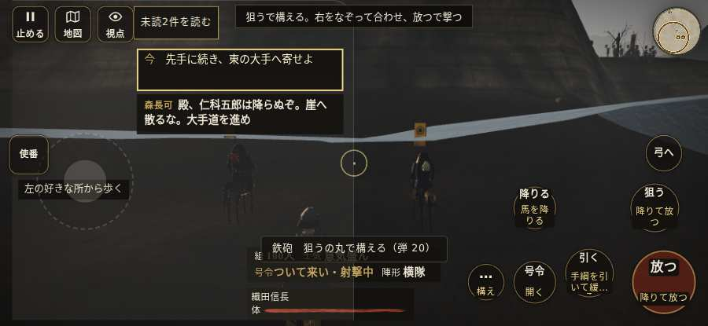

# テストプレイヤーの感想：歴史好きの大人

- 人：ミチオ（62歳・郷土史の会）（9366番）
- 変わり目：走りっぱなし・iPhone 横 932×430・信長で出陣・ふつう・身分 少し上・問屋:鉄砲・一人称・感度 敏感・途中で止める
- 時：2026/10/11 2:19:30（303秒かかった）
- 画面：iPhone の横向き 932×430・倍率3・指で触る操作（touch.js の釦・棒・なぞり）・画質 低
- 遊んだ戦：高遠城の戦い（信長で出陣）（試験の持ち時間で打ち切り）（失敗）
- 機械の混み具合：4（load average）

## ひとこと

> 高遠城（信長で出陣）（試験の持ち時間で打ち切り）を、一人称で歩いて見て回りました。務めは果たせませんでしたが、それより気になる所があります。行き先があるのに20秒動かない兵。細かい事ですが、こういう所で嘘っぽくなる。前へ進もうとしても進めない所があった。史実を知る者としては、ここは看過できません。門・柵を破れと言うのに、90秒だれも傷つけていない。これでは興が醒めます。

## 見つけた問題（5件・困った順）

### 1. 行き先があるのに20秒動かない兵
- どこで：高遠城の戦い（信長で出陣）・104秒・assault
- 何が：敵の足軽：敵の足軽（号令：attack・城方の控え・頭：無/―・近い敵37m）at (41,-37)／敵の侍：敵の侍（号令：attack・城方の控え・頭：無/―・近い敵36m）at (42,-37)
- どれくらい困ったか：★★★ やめたくなった（12回）
- 直し方の目安：道が塞がれていないか、行き先に着いたと見なせているかを見る
- 画面：（その戦の山場の一枚）

### 2. 門・柵を破れと言うのに、90秒だれも傷つけていない
- どこで：高遠城の戦い（信長で出陣）・175秒・assault
- 何が：「大手門（一の門）を破れ」（assault）
- どれくらい困ったか：★★ かなり困った（2回）
- 直し方の目安：門を打つ組（g.assault）が門まで行けているか、遊び手が E で打てる所に印があるかを見る
- 画面：（その戦の山場の一枚）

### 3. 前へ進もうとしても進めない所があった
- どこで：高遠城の戦い（信長で出陣）・33秒・assault
- 何が：(23, -98)・段 assault
- どれくらい困ったか：★★ かなり困った（1回）
- 直し方の目安：当たり（柵・建物・地形）と道のつながりを見直す
- 画面：

### 4. 前へ進もうとしても進めない所があった
- どこで：高遠城の戦い（信長で出陣）・70秒・assault
- 何が：(38, -98)・段 assault
- どれくらい困ったか：★★ かなり困った（1回）
- 直し方の目安：当たり（柵・建物・地形）と道のつながりを見直す
- 画面：（その戦の山場の一枚）

### 5. 門が壊れないまま戦が終わった（任務は落とした）
- どこで：高遠城の戦い（信長で出陣）・終わり（384秒）
- 何が：大手門 hp 170/380、二の丸の門 hp 380/380、本丸門（一の門） hp 380/380、本丸の門 hp 380/380、搦手門 hp 380/380
- どれくらい困ったか：★ 少し気になった（1回）
- 直し方の目安：門を打つ組の行き先と、門の hp（掛矢・味方の打ち手の傷の大きさ）を見直す
- 画面：（その戦の山場の一枚）

## 遊んだ記録

- 高遠城の戦い（信長で出陣）（試験の持ち時間で打ち切り）（戦の任務とは別に、試験全体の持ち時間が尽きた）：384秒・任務失敗・戦功0・組100/100・討ち取り1・突き5/当たり5・号令0回・指で押した数28・読み込み3.6秒・戦の前の札106字・1コマ30.9ms（実時間260秒・内訳 brain 0.2・pad 0.1・tf 0.5・upd 29.9・eye 0.2）
  - 任務の流れ：0s 先手に続き、東の大手へ寄せよ → 8s 大手門（一の門）を破れ → 60s 打って出た城兵を押し返せ → 124s 大手門を通り、三の丸へ入れ → 145s 大手門（一の門）を破れ → 302s 大手門を破れ → 339s 大手門を通り、三の丸へ入れ
  - 味方の隊：隊9・動いた計332m・味方の討ち取り0・敵を前に20秒止まった116回・本物の味方5人未満0秒
  - 受けた傷：武将 187・侍 1
  - 開戦：
  - 一人称で見回す（45秒）：
