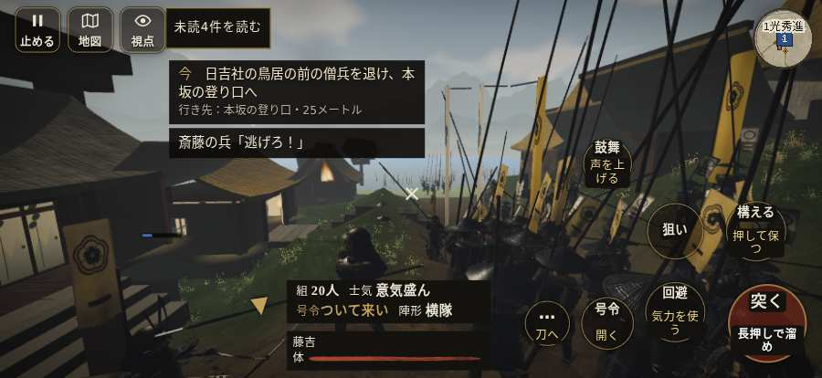

# テストプレイヤーの感想：アクション好き

- 人：ソウタ（24歳・アクションゲーム好き）（9397番）
- 変わり目：迷子になりやすい・iPhone 横 874×402・新しく始める通し・速い・身分 少し上・問屋:鉄砲・三人称・感度 鈍い・途中で止める
- 時：2026/10/11 2:19:09（214秒かかった）
- 画面：iPhone の横向き 874×402・倍率3・指で触る操作（touch.js の釦・棒・なぞり）・画質 低
- 遊んだ戦：比叡山攻め（失敗）
- 機械の混み具合：2（load average）

## ひとこと

> とにかく突っ込んだ。8分で1人斬った。2回突いて2回当たり。当たりはいい感じ。前へ進もうとしても進めない所があった、もったいない。「親指の棒（歩く）」を押そうとしたら、別の物に当たった、手応えがスカスカ。斬り合う相手が少なくて退屈、ストレスたまる。もっと派手に、じゃなくて重く斬り合いたい。

## 見つけた問題（5件・困った順）

### 1. 前へ進もうとしても進めない所があった
- どこで：比叡山攻め・33秒・climb
- 何が：(149, 0)・段 climb
- どれくらい困ったか：★★ かなり困った（12回）
- 直し方の目安：当たり（柵・建物・地形）と道のつながりを見直す
- 画面：

### 2. 死んだ相手を3秒以上狙い続けている
- どこで：比叡山攻め・295秒・climb
- 何が：敵の足軽：敵の足軽
- どれくらい困ったか：★★ かなり困った（5回）
- 直し方の目安：相手が倒れたら狙いを外す
- 画面：（その戦の山場の一枚）

### 3. 「親指の棒（歩く）」を押そうとしたら、別の物に当たった
- どこで：比叡山攻め・12秒・climb
- 何が：指の下にあったのは #battle-message > #subtitle > span「殿の本陣は南の三井寺、山岡殿」
- どれくらい困ったか：★★ かなり困った（1回）
- 直し方の目安：重ねている札の置き場所をずらすか、pointer-events:none にする
- 画面：

### 4. 押せる所が小さい（28px 未満）
- どこで：比叡山攻め・戦のあと
- 何が：.ek-in > .note > .word-help：26×44「戦功」／.ek-c > b > .word-help：26×47「知行」
- どれくらい困ったか：★ 少し気になった（5回）
- 直し方の目安：押せる大きさを 28px 以上に
- 画面：（その戦の山場の一枚）

### 5. 斬り合う相手が少なくて退屈
- どこで：比叡山攻め・495秒・climb
- 何が：8分で1人
- どれくらい困ったか：★ 少し気になった（1回）
- 画面：（その戦の山場の一枚）

## 遊んだ記録

- 比叡山攻め：480秒・任務失敗・戦功0・組17/20・討ち取り1・突き2/当たり2・号令0回・指で押した数6・読み込み2.2秒・戦の前の札135字・1コマ17.4ms（実時間189秒・内訳 brain 0.1・pad 0.1・tf 0.3・upd 16.8・eye 0.1）
  - 任務の流れ：0s 明智光秀のもとで、坂本から山へ登れ → 12s 日吉社の鳥居の前の僧兵を退け、本坂の登り口へ → 480s 日吉社の鳥居の前の僧兵を退け、本坂の登り口へ〔失〕
  - 味方の隊：隊7・動いた計551m・味方の討ち取り27・敵を前に20秒止まった68回・本物の味方5人未満0秒
  - 開戦：
