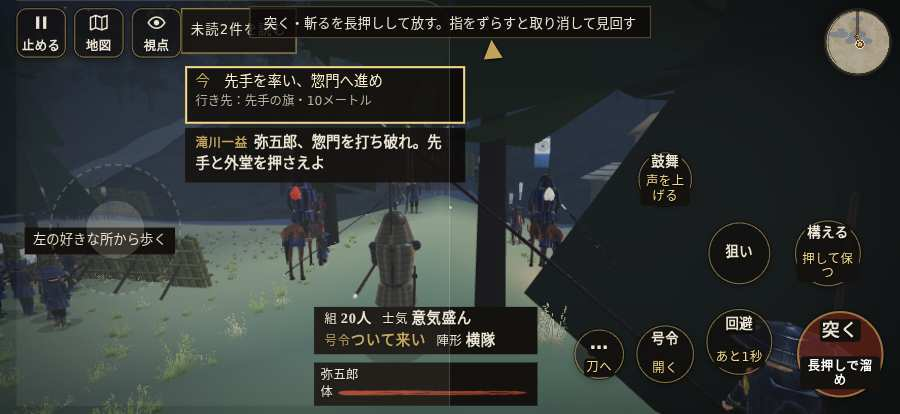

# テストプレイヤーの感想：歴史好きの大人

- 人：ミチオ（62歳・郷土史の会）（9416番）
- 変わり目：構え多め・iPhone 横 874×402・新しく始める通し・ふつう・身分 中ほど・問屋:馬・三人称・感度 鈍い・途中で止める
- 時：2026/10/11 2:18:29（302秒かかった）
- 画面：iPhone の横向き 874×402・倍率3・指で触る操作（touch.js の釦・棒・なぞり）・画質 低
- 遊んだ戦：越前・大滝寺の夜討ち（試験の持ち時間で打ち切り）（失敗）
- 機械の混み具合：4（load average）

## ひとこと

> 越前・大滝寺の夜討ち（試験の持ち時間で打ち切り）を、一人称で歩いて見て回りました。務めは果たせませんでしたが、それより気になる所があります。行き先があるのに20秒動かない兵。当時の人が見たら首を傾げるでしょう。名のある武将なのに、顔も装束も並の侍と同じ。史実を知る者としては、ここは看過できません。前へ進もうとしても進めない所があった。細かい事ですが、こういう所で嘘っぽくなる。

## 見つけた問題（6件・困った順）

### 1. 行き先があるのに20秒動かない兵
- どこで：越前・大滝寺の夜討ち・103秒・climb
- 何が：味方の足軽：味方の足軽（号令：attack・物見・頭：full/pursue・近い敵9m）at (9,-86)／味方の足軽：味方の足軽（号令：attack・物見・頭：full/engage・近い敵18m）at (9,-86)
- どれくらい困ったか：★★★ やめたくなった（27回）
- 直し方の目安：道が塞がれていないか、行き先に着いたと見なせているかを見る
- 画面：（その戦の山場の一枚）

### 2. 前へ進もうとしても進めない所があった
- どこで：越前・大滝寺の夜討ち・35秒・climb
- 何が：(-1, -153)・段 climb
- どれくらい困ったか：★★ かなり困った（1回）
- 直し方の目安：当たり（柵・建物・地形）と道のつながりを見直す
- 画面：

### 3. 「親指の棒（歩く）」を押そうとしたら、別の物に当たった
- どこで：越前・大滝寺の夜討ち・178秒・climb
- 何が：指の下にあったのは #hud.battle-active.hudmin > #battle-notices > #objectives「任務の一覧を開く。残り 2件・済 0件・失敗 0件」
- どれくらい困ったか：★★ かなり困った（1回）
- 直し方の目安：重ねている札の置き場所をずらすか、pointer-events:none にする
- 画面：（その戦の山場の一枚）

### 4. 名のある武将なのに、顔も装束も並の侍と同じ
- どこで：越前・大滝寺の夜討ち・125秒・climb
- 何が：寺の指揮役（敵）
- どれくらい困ったか：★ 少し気になった（19回）
- 直し方の目安：units.js の GENERALS に顔・甲冑・兜を足す
- 画面：（その戦の山場の一枚）

### 5. 号令「突撃」から3秒たっても、組の7割が動かない
- どこで：越前・大滝寺の夜討ち・197秒・climb
- 何が：20人のうち動いたのは0人（越前・大滝寺の夜討ち・197秒・climb）
- どれくらい困ったか：★ 少し気になった（1回）
- 直し方の目安：号令を受けた兵がすぐ向きを変えて動き出すようにする（行き先・狙いの付け直し）
- 画面：（その戦の山場の一枚）

### 6. 号令「続け」から3秒たっても、組の7割が動かない
- どこで：越前・大滝寺の夜討ち・211秒・climb
- 何が：20人のうち動いたのは1人（越前・大滝寺の夜討ち・211秒・climb）
- どれくらい困ったか：★ 少し気になった（1回）
- 直し方の目安：号令を受けた兵がすぐ向きを変えて動き出すようにする（行き先・狙いの付け直し）
- 画面：（その戦の山場の一枚）

## 遊んだ記録

- 越前・大滝寺の夜討ち（試験の持ち時間で打ち切り）（戦の任務とは別に、試験全体の持ち時間が尽きた）：403秒・任務失敗・戦功25・組16/20・討ち取り5・突き17/当たり17・号令43回・指で押した数88・読み込み2.6秒・戦の前の札142字・1コマ29.6ms（実時間262秒・内訳 brain 0.3・pad 0.1・tf 0.5・upd 28.5・eye 0.2）
  - 任務の流れ：0s 先手を率い、惣門へ進め → 5s 惣門を破れ。味方と外堂を取れ → 84s 外堂を押さえ、印へ → 234s 山門を破れ。味方と本堂を取れ → 266s 本堂を押さえ、印へ → 376s 火を避け、味方と奥の院を取れ
  - 味方の隊：隊13・動いた計2682m・味方の討ち取り69・敵を前に20秒止まった13回・本物の味方5人未満0秒
  - 受けた傷：足軽 56
  - 開戦：
  - 一人称で見回す（45秒）：
