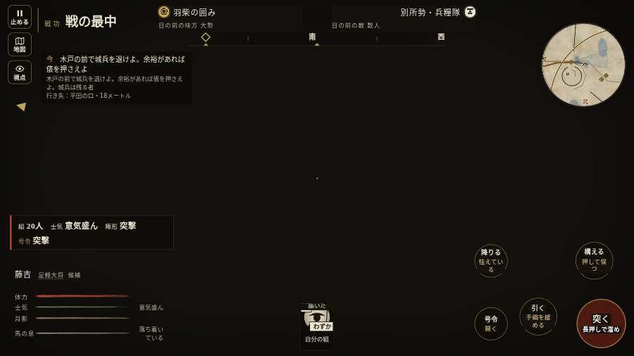

# テストプレイヤーの感想：アクション好き

- 人：ソウタ（24歳・アクションゲーム好き）（9782番）
- 変わり目：構え多め・パソコン 1280×720・織田家編の戦を一つ・ゆっくり・身分 上・問屋:鉄砲・一人称・感度 ふつう・途中で止める
- 時：2026/10/12 0:40:44（278秒かかった）
- 画面：パソコン 1280×720・鍵盤とマウス・画質 低
- 遊んだ戦：三木城・大村の合戦（失敗・倒れた）
- 機械の混み具合：5（load average）

## ひとこと

> とにかく突っ込んだ。4分で0人斬った。前へ進もうとしても進めない所があった、手応えがスカスカ。HUD の札どうしが重なって読めない、ストレスたまる。倒れて戦が終わった、手応えがスカスカ。1回やられた。難しいのはいいけど、何でやられたか分かるようにしてほしい。

## 見つけた問題（6件・困った順）

### 1. HUD の札どうしが重なって読めない
- どこで：三木城・大村の合戦・230秒・convoy
- 何が：#mobfx と .mk.edge（1280×720）／#mobfx と .plaque（1280×720）
- どれくらい困ったか：★★ かなり困った（32回）
- 直し方の目安：置き場所をずらすか、片方を出している間はもう片方を隠す
- 画面：（その戦の山場の一枚）

### 2. 前へ進もうとしても進めない所があった
- どこで：三木城・大村の合戦・38秒・convoy
- 何が：(-97, -49)・段 convoy
- どれくらい困ったか：★★ かなり困った（5回）
- 直し方の目安：当たり（柵・建物・地形）と道のつながりを見直す
- 画面：

### 3. 倒れて戦が終わった
- どこで：三木城・大村の合戦・277秒・convoy
- 何が：261秒で倒れた（受けた傷：侍 77・足軽 58）
- どれくらい困ったか：★★ かなり困った（1回）
- 直し方の目安：初めの戦は受ける傷を減らす・危ない時に字幕で構えを教える
- 画面：（その戦の山場の一枚）

### 4. 戦場が札に食われている（画面の3分の1超）
- どこで：三木城・大村の合戦・230秒・convoy
- 何が：1280×720 で 100%
- どれくらい困ったか：★ 少し気になった（3回）
- 直し方の目安：札を小さくするか、平時は薄く・畳む
- 画面：（その戦の山場の一枚）

### 5. 自分のすぐそばの敵が6秒以上なにもしない
- どこで：三木城・大村の合戦・234秒・convoy
- 何が：敵の足軽：敵の足軽
- どれくらい困ったか：★ 少し気になった（2回）
- 直し方の目安：近くの敵（遊び手）を狙いに入れる
- 画面：（その戦の山場の一枚）

### 6. 斬り合う相手が少なくて退屈
- どこで：三木城・大村の合戦・277秒・convoy
- 何が：4分で0人
- どれくらい困ったか：★ 少し気になった（1回）
- 画面：（その戦の山場の一枚）

## 遊んだ記録

- 三木城・大村の合戦：261秒・任務失敗（倒れた）・戦功0・組9/20・討ち取り0・突き0/当たり0・号令1回・指で押した数7・読み込み18.2秒・戦の前の札186字・1コマ30.8ms（実時間211秒・内訳 brain 0.1・pad 0.1・tf 0.3・upd 30.1・eye 0.1）
  - 任務の流れ：0s 西の槍組へ。兵糧の護衛を退けよ → 12s 槍組と共に護衛を退けよ。荷を通すな → 30s 平田の口を守れ。城兵を押し返せ → 30s 木戸の前で城兵を退けよ。余裕があれば俵を押さえよ
  - 味方の隊：隊12・動いた計957m・味方の討ち取り43・敵を前に20秒止まった47回・本物の味方5人未満0秒
  - 受けた傷：侍 77・足軽 58
  - 開戦：
  - 山場：
