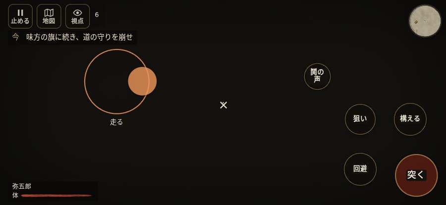

# テストプレイヤーの感想：アクション好き

- 人：ソウタ（24歳・アクションゲーム好き）（9832番）
- 変わり目：迷子になりやすい・iPhone 横 874×402・新しく始める通し・速い・足軽から・問屋:供・一人称・感度 ふつう・止めない
- 時：2026/10/12 0:41:37（305秒かかった）
- 画面：iPhone の横向き 874×402・倍率3・指で触る操作（touch.js の釦・棒・なぞり）・画質 低
- 遊んだ戦：桶狭間の戦い（試験の持ち時間で打ち切り）（失敗・倒れた）
- 機械の混み具合：3（load average）

## ひとこと

> とにかく突っ込んだ。6分で7人斬った。23回突いて23回当たり。当たりはいい感じ。押せる所が小さい、もったいない。倒れて戦が終わった、ストレスたまる。1回やられた。難しいのはいいけど、何でやられたか分かるようにしてほしい。

## 見つけた問題（2件・困った順）

### 1. 押せる所が小さい（28px 未満）
- どこで：桶狭間の戦い・5秒・brief
- 何が：#battle-notices > #objectives > #obj-list：238×20「「今」の任務を進めよう。」／#battle-notices > #objectives > #obj-list：281×20「「今」の任務を進めよう。」
- どれくらい困ったか：★★ かなり困った（62回）
- 直し方の目安：押せる大きさを 28px 以上に
- 画面：（その戦の山場の一枚）

### 2. 倒れて戦が終わった
- どこで：桶狭間の戦い・419秒・assault
- 何が：334秒で倒れた（受けた傷：武将 63・侍 52・足軽 12）
- どれくらい困ったか：★★ かなり困った（1回）
- 直し方の目安：初めの戦は受ける傷を減らす・危ない時に字幕で構えを教える
- 画面：（その戦の山場の一枚）

## 遊んだ記録

- 桶狭間の戦い（試験の持ち時間で打ち切り）（戦の任務とは別に、試験全体の持ち時間が尽きた）：334秒・任務失敗（倒れた）・戦功20・組—・討ち取り7・突き23/当たり23・号令0回・指で押した数107・読み込み1.9秒・戦の前の札0字・1コマ29.9ms（実時間276秒・内訳 brain 0.2・pad 0.1・tf 0.2・upd 29.3・eye 0.1）
  - 任務の流れ：0s 組頭の旗へ進み、下知を聞け → 4s 組頭の旗へ進み、下知を聞け〔済〕 → 7s すぐ先の組の旗について進め → 27s 雨が弱まるまで組のそばで構え、かかれの合図を待て → 44s 味方の旗に続き、道の守りを崩せ → 105s 味方と本陣の幕の口へ寄せよ → 116s 組とともに、義元を囲む旗本を三人崩せ → 188s 味方と義元の囲みを押せ。服部と毛利を通せ → 216s 服部と毛利に続き、義元の旗本へ寄せよ
  - 味方の隊：隊8・動いた計1431m・味方の討ち取り59・敵を前に20秒止まった3回・本物の味方5人未満0秒
  - 受けた傷：武将 63・侍 52・足軽 12
  - 開戦：
  - 山場：
  - 終わり近く：
