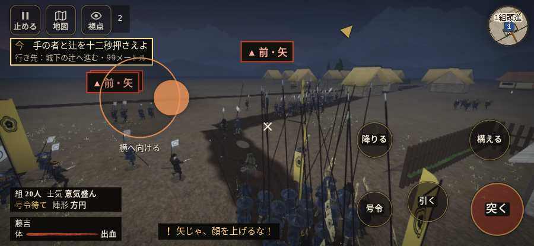

# テストプレイヤーの感想：指揮好きの戦略家

- 人：ケイコ（45歳・将棋と戦略ゲーム好き）（9878番）
- 変わり目：連打・iPhone 横 844×390・織田家編の戦を一つ・速い・身分 上・問屋:刀・槍・具足・三人称・感度 敏感・止めない
- 時：2026/10/12 1:10:57（120秒かかった）
- 画面：iPhone の横向き 844×390・倍率3・指で触る操作（touch.js の釦・棒・なぞり）・画質 低
- 遊んだ戦：有岡城の戦い（失敗・倒れた）
- 機械の混み具合：3（load average）

## ひとこと

> 有岡城で、号令を6回かけました。号令「陣形」が、指の号令の輪から出せない。指揮官としてはもどかしい。倒れて戦が終わった。命令が信用できないと、策が立てられません。采配で負けたのか、操作で負けたのか分からないのが一番困ります。

## 見つけた問題（2件・困った順）

### 1. 号令「陣形」が、指の号令の輪から出せない
- どこで：有岡城の戦い・2秒・brief
- 何が：号令の輪（RADIAL）に無い、または身分が足りず選べない（有岡城の戦い・2秒・brief）
- どれくらい困ったか：★★★ やめたくなった（1回）
- 直し方の目安：号令の輪に足すか、短く押した時の指揮の札（数字の号令）を指で押せるようにする
- 画面：（その戦の山場の一枚）

### 2. 倒れて戦が終わった
- どこで：有岡城の戦い・67秒・open
- 何が：51秒で倒れた（受けた傷：侍 66・足軽 44・弓 1）
- どれくらい困ったか：★ 少し気になった（1回）
- 直し方の目安：初めの戦は受ける傷を減らす・危ない時に字幕で構えを教える
- 画面：（その戦の山場の一枚）

## 遊んだ記録

- 有岡城の戦い：51秒・任務失敗（倒れた）・戦功20・組20/20・討ち取り1・突き9/当たり8・号令6回・指で押した数24・読み込み2.9秒・戦の前の札132字・1コマ40.4ms（実時間82秒・内訳 brain 0.2・pad 0.2・tf 0.2・upd 39.6・eye 0.2）
  - 任務の流れ：0s 手の者をそろえ、木戸の前で合図を待て → 8s 先手に続き、木戸の先の敵を退けよ → 29s 組と城下の辻へ進め → 39s 手の者と辻を十二秒押さえよ
  - 味方の隊：隊14・動いた計838m・味方の討ち取り5・敵を前に20秒止まった3回・本物の味方5人未満0秒
  - 受けた傷：侍 66・足軽 44・弓 1
  - 開戦：
  - 山場：
  - 勝ち負けが決まった所：
