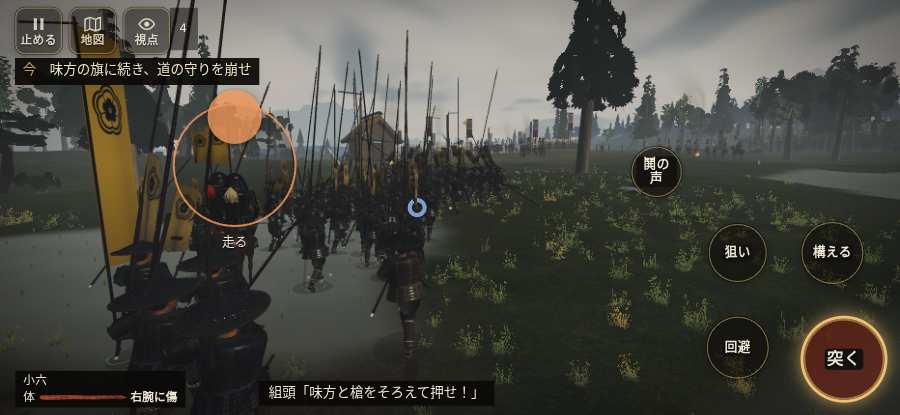

# テストプレイヤーの感想：指揮好きの戦略家

- 人：ケイコ（45歳・将棋と戦略ゲーム好き）（9893番）
- 変わり目：走りっぱなし・iPhone 横 932×430・織田家編の戦を一つ・ゆっくり・足軽から・問屋:供・三人称・感度 ふつう・途中で止める
- 時：2026/10/12 0:47:22（241秒かかった）
- 画面：iPhone の横向き 932×430・倍率3・指で触る操作（touch.js の釦・棒・なぞり）・画質 低
- 遊んだ戦：桶狭間の戦い（達成）
- 機械の混み具合：2（load average）

## ひとこと

> 桶狭間で、号令を0回かけました。押せる所が小さい。指揮官としてはもどかしい。この戦では号令できる組が無い。ここが直れば、ぐっと指揮が楽しくなる。勝てはしましたが、自分の采配で勝った手応えはまだ薄いです。

## 見つけた問題（2件・困った順）

### 1. 押せる所が小さい（28px 未満）
- どこで：桶狭間の戦い・5秒・brief
- 何が：#battle-notices > #objectives > #obj-list：238×20「「今」の任務を進めよう。」／#battle-notices > #objectives > #obj-list：284×20「「今」の任務を進めよう。」
- どれくらい困ったか：★★ かなり困った（61回）
- 直し方の目安：押せる大きさを 28px 以上に
- 画面：（その戦の山場の一枚）

### 2. この戦では号令できる組が無い（指揮する所が無い）
- どこで：桶狭間の戦い・331秒・assault
- 何が：桶狭間の戦い
- どれくらい困ったか：★ 少し気になった（1回）
- 画面：（その戦の山場の一枚）

## 遊んだ記録

- 桶狭間の戦い：331秒・任務達成・戦功85・組—・討ち取り1・突き6/当たり6・号令0回・指で押した数39・読み込み2.0秒・戦の前の札0字・1コマ26.7ms（実時間213秒・内訳 brain 0.1・pad 0.1・tf 0.3・upd 26.2・eye 0.1）
  - 任務の流れ：0s 組頭の旗へ進み、下知を聞け → 2s 組頭の旗へ進み、下知を聞け〔済〕 → 5s すぐ先の組の旗について進め → 23s 雨が弱まるまで組のそばで構え、かかれの合図を待て → 40s 味方の旗に続き、道の守りを崩せ → 105s 味方と本陣の幕の口へ寄せよ → 109s 組とともに、義元を囲む旗本を三人崩せ → 138s 組とともに、義元の幕の口へ寄せよ → 139s 味方と義元の囲みを押せ。服部と毛利を通せ → 159s 服部と毛利に続き、義元の旗本へ寄せよ → 301s 深田へ逃げる今川勢を、組と追い討て → 321s 追うのはここまで。帰る組の旗へ集まれ → 331s 追うのはここまで。帰る組の旗へ集まれ〔済〕
  - 味方の隊：隊8・動いた計1045m・味方の討ち取り67・敵を前に20秒止まった0回・本物の味方5人未満0秒
  - 受けた傷：侍 46・弓 9・足軽 7
  - 開戦：
  - 山場：
  - 勝ち負けが決まった所：
